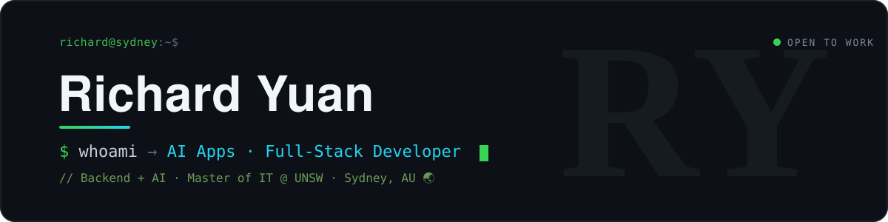

<!-- ===== 手做头图(自托管 SVG,永不裂图) ===== -->
<p align="center">
  
</p>

```yaml
# ~ whoami
name:        Richard Yuan  (@Tardisyuan)
education:   Master of IT @ UNSW
experience:  2+ years · backend engineering
focus:       [ AI apps, Full-Stack, Distributed Systems ]
status:      open to AI application and Full-Stack roles  ✅
```

## `$ ./featured`

**[J.A.R.V.I.S.](https://github.com/Tardisyuan/jarvis-showcase)**: a household voice butler on your own server, where risky actions are checked by code, not left to the model.

It knows who is speaking, acts within what you grant, and leaves a receipt for everything. Built solo: I set the direction, the rules and the reviews; AI agents write the code.

**[Live demo](https://jarvis-demo.tardisyuan.ltd/?lang=en)** · [How it is built](https://jarvis-demo.tardisyuan.ltd/how) · [Project page](https://github.com/Tardisyuan/jarvis-showcase)

<a href="https://github.com/Tardisyuan/jarvis-showcase"></a>


## `$ tech --stack`

<div align="center">

`AI apps · Python`


`Backend · Data`


`Frontend`


`Cloud · Ops`


</div>

## `$ git log --stat`

<div align="center">

<!-- 自生成 3D 贡献日历:真实提交 + 连续天数 + 日均,由本仓库 Action 每日刷新,零第三方依赖 -->


</div>

## `$ git log --graph`

<div align="center">

<!-- 贪吃蛇:自生成,自动跟随访客深色 / 浅色模式 -->
<picture>
  <source media="(prefers-color-scheme: dark)" srcset="https://raw.githubusercontent.com/Tardisyuan/Tardisyuan/output/github-contribution-grid-snake-dark.svg"/>
  <source media="(prefers-color-scheme: light)" srcset="https://raw.githubusercontent.com/Tardisyuan/Tardisyuan/output/github-contribution-grid-snake.svg"/>
  
</picture>

</div>

---

<div align="center">

<a href="mailto:tardisyuan@gmail.com"></a>
&nbsp;
<a href="https://github.com/Tardisyuan"></a>

<sub><code>$ echo "let's build something great together"</code></sub>

</div>
